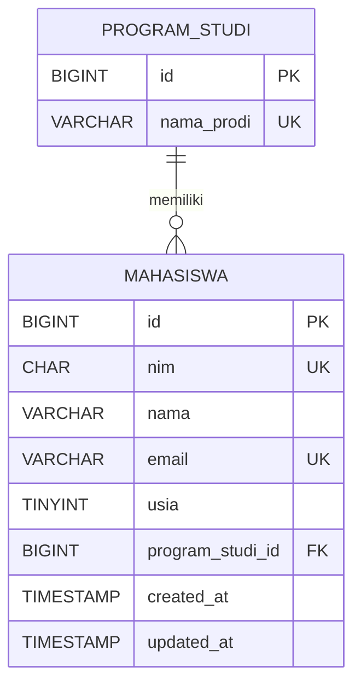

# ERD Pertemuan 4 — Praktikum Web

## 1. Entitas dan Atribut

### Tabel `program_studi`
- `id` — Primary Key (PK)
- `nama_prodi` — Nama program studi, wajib diisi dan unik

### Tabel `mahasiswa`
- `id` — Primary Key (PK)
- `nim` — Nomor induk mahasiswa, wajib diisi dan unik
- `nama` — Nama mahasiswa
- `email` — Email mahasiswa, wajib diisi dan unik
- `usia` — Usia mahasiswa, dibatasi antara 17–60 tahun
- `program_studi_id` — Foreign Key (FK) yang mengacu ke `program_studi.id`
- `created_at` — Waktu data dibuat
- `updated_at` — Waktu data diperbarui

## 2. Entity Relationship Diagram (ERD)

## 3. Penjelasan Relasi

Relasi antara `program_studi` dan `mahasiswa` adalah **one-to-many (1:N)**. Satu program studi dapat memiliki banyak mahasiswa, sedangkan setiap mahasiswa terhubung dengan satu program studi melalui `program_studi_id`.

Primary Key digunakan untuk mengidentifikasi setiap baris secara unik. Foreign Key menjaga agar mahasiswa hanya dapat terhubung dengan program studi yang tersedia.